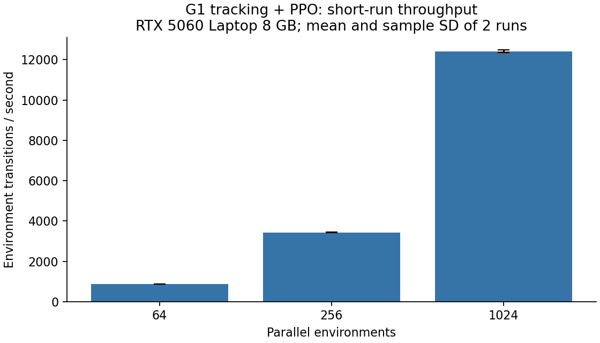

# G1 tracking performance results

Measured on 2026-11-03. Real simulation and PPO updates; random initialization, 3 warmup and 8 measured iterations per seed (42, 43), 24 steps per environment per iteration. No video, checkpoint writing or external logging.

| Environments | PyTorch CPU threads | Transitions/s mean ± sample SD | Mean iteration (s) | Peak PyTorch allocated (MiB) |
|---:|---:|---:|---:|---:|
| 64 | 24 | 872.8 ± 0.4 | 1.760 | 83.7 |
| 256 | 24 | 3433.2 ± 16.8 | 1.790 | 116.9 |
| 1024 | 24 | 12420.4 ± 58.7 | 1.979 | 248.9 |
| 1024 | 1 | 11853.0 ± 553.0 | 2.076 | 248.9 |

## Findings

- Raising parallelism from 64 to 1024 increased measured transition throughput by 14.23x. PPO batch size also increased 16x; this is a configuration scaling result, not a code speedup or evidence of faster learning.
- At 1024 environments, the environment-step CUDA event span averaged 1844 ms per iteration, compared with 22 ms for action inference and 93 ms for PPO updates. These spans include host submission/stream gaps and do not isolate physics kernels.
- Setting OMP_NUM_THREADS=1 changed mean throughput by -4.6% relative to the default 24-thread run at 1024 environments. With two repeats and no clock/desktop-load control, this is not sufficient evidence of a reliable optimization.
- Loss/reward/termination values are retained in the raw files. No final policy-quality or convergence evaluation was performed.

## Scope and reproduction

The task is upstream mjlab tracking with the existing Quick_Jab motion, not the historical boxing reward patches. PyTorch memory excludes Warp and other allocations. Package versions, task/configuration, source/motion hashes and every iteration are included in the JSON files.

The environment matrix was run in fixed order (64, 256, 1024 for seed 42, then seed 43); the thread comparison followed it. GPU clocks and all desktop activity were not controlled. Results are local short-run observations.

See [methodology and commands](../../training-performance.md). `summary.csv` contains computed summaries; `default_*.json` and `threads1_*.json` contain raw measurements.
